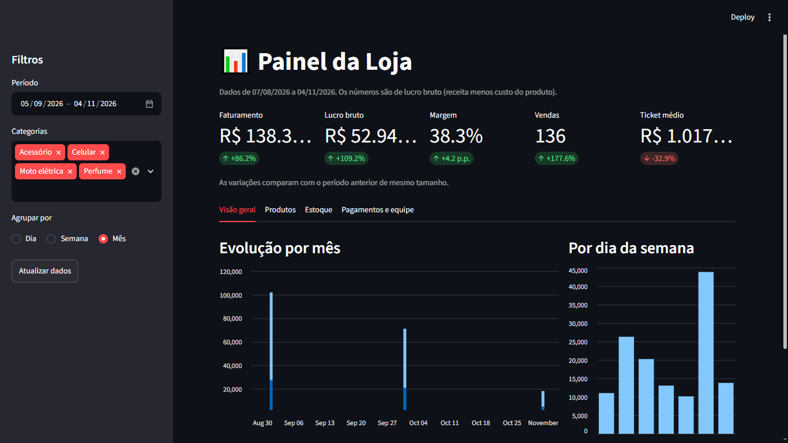
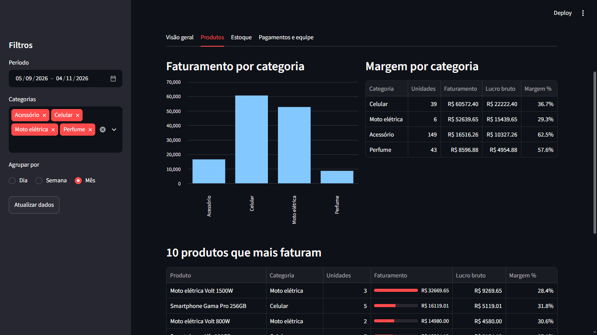
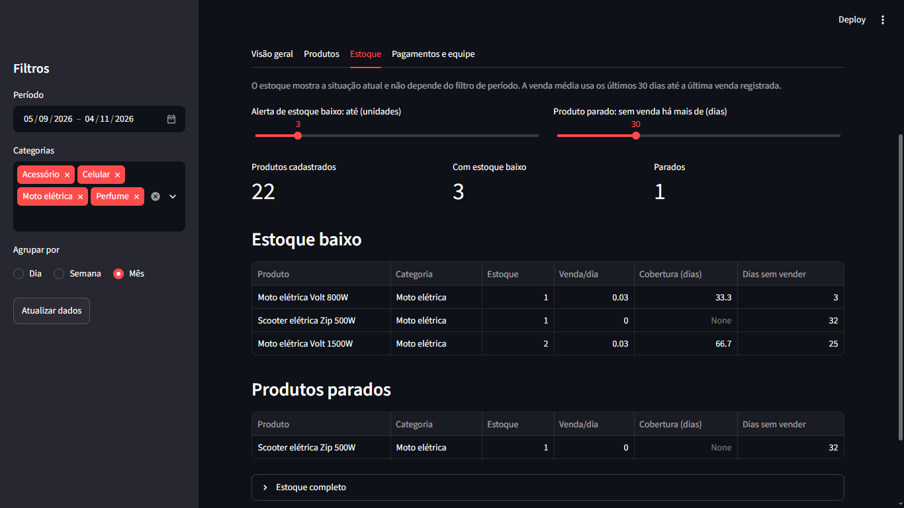
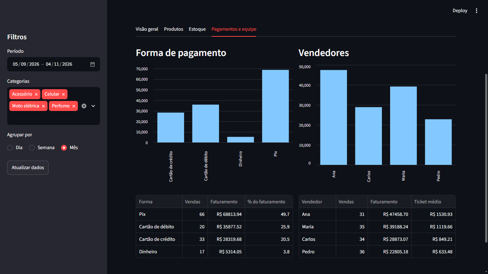
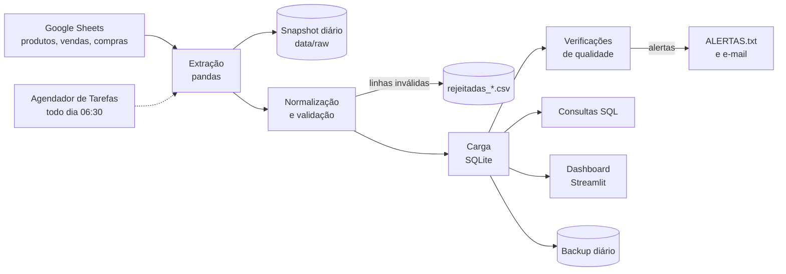

# Loja Data Pipeline


Pipeline de dados de ponta a ponta para uma loja física de celulares, motos elétricas, acessórios e perfumes: coleta os registros da loja em uma planilha, valida e transforma em Python, carrega em um banco com modelo dimensional, executa todo dia sozinho, avisa quando algo está errado e entrega um dashboard para o dono decidir com dados.

> O repositório contém apenas **dados fictícios**. Os dados reais da loja nunca são versionados.



## Contexto de negócio

Projeto desenvolvido para uma loja física real, em fase de inauguração, e usado como projeto de portfólio em engenharia de dados.

- **Produtos:** celulares, motos elétricas, acessórios e perfumes
- **Registro hoje:** planilha e WhatsApp
- **Pagamentos aceitos:** Pix, cartão (débito e crédito) e dinheiro
- **Garantia:** 1 ano na bateria e 3 meses nos acessórios, com assistência técnica
- **Volume inicial estimado:** cerca de 2 vendas por dia, com ações sazonais planejadas
- **Objetivo:** acompanhar o funcionamento da loja com dados para decidir o que comprar, o que promover e onde ajustar

## Destaques

- **Modelo dimensional** (esquema estrela) com custo gravado no momento da venda
- **Validação de dados** com 9 regras para vendas; linhas inválidas são isoladas em arquivo, sem derrubar o pipeline
- **Carga idempotente** com transação e reconciliação de totais
- **14 consultas SQL** de negócio, incluindo funções de janela e curva ABC
- **Dashboard** em Streamlit com KPIs comparados ao período anterior
- **Operação:** execução diária agendada, alertas de qualidade (e-mail opcional), backup e cópia diária da planilha
- **33 testes automatizados** rodando no GitHub Actions, junto com o pipeline completo e as consultas SQL

## Dashboard

Painel em Streamlit (`streamlit run dashboards/app.py`) com filtros por período, categoria e agrupamento (dia, semana ou mês). Os indicadores do topo são comparados ao período anterior de mesmo tamanho. As telas abaixo usam dados fictícios.

**Visão geral:** faturamento, lucro, margem, vendas e ticket médio, evolução no tempo e vendas por dia da semana.


**Produtos:** faturamento e margem por categoria, os 10 produtos que mais faturam e a curva ABC.



**Estoque:** alertas de estoque baixo e de produtos parados, com limites ajustáveis.



**Pagamentos e equipe:** participação de Pix, débito, crédito e dinheiro, e desempenho dos vendedores.



## Arquitetura



## Stack

Python 3.12+, pandas, SQL (SQLite), Streamlit, pytest, GitHub Actions, Agendador de Tarefas do Windows.

## Estrutura do projeto

```
loja-data-pipeline/
├── config/settings.py            # caminhos, abas da planilha, formas de pagamento
├── src/
│   ├── extract.py                # lê as abas (planilha ou CSVs) e guarda snapshot
│   ├── transform.py              # limpeza e padronização
│   ├── validate.py               # regras de qualidade de dados
│   ├── load.py                   # carga no SQLite
│   ├── checks.py                 # alertas após a carga
│   ├── notificar.py              # e-mail opcional
│   └── pipeline.py               # orquestra o ETL
├── sql/
│   ├── 01_create_tables.sql      # modelo dimensional
│   ├── 02_views.sql              # estoque atual e vendas diárias
│   └── 03_analises.sql           # 14 consultas de negócio
├── dashboards/
│   ├── dados.py                  # cálculo das métricas (testável)
│   └── app.py                    # interface Streamlit
├── scripts/
│   ├── gerar_dados_ficticios.py
│   ├── rodar_consulta.py         # executa as consultas pelo terminal
│   ├── backup.py
│   └── executar_pipeline.bat     # usado pelo Agendador de Tarefas
├── tests/                        # 33 testes
├── .github/workflows/ci.yml      # integração contínua
├── data/sample/                  # dados fictícios (únicos versionados)
└── docs/                         # diagrama do modelo e prints do painel
```

## Modelo de dados


Esquema estrela com `fato_vendas` e `fato_compras` ao centro, cercadas pelas dimensões `dim_produto`, `dim_tempo`, `dim_vendedor` e `dim_cliente`.

- **Granularidade:** uma linha de `fato_vendas` por item vendido (uma venda com dois itens gera duas linhas com o mesmo `id_venda`).
- **Custo no momento da venda:** `custo_total` é gravado na venda, então a margem histórica não muda quando o custo do produto muda.
- **Chave natural e substituta:** `sku` identifica o produto no negócio; `id_produto` é a chave do banco.
- **Estoque derivado:** o estoque atual é calculado pela view `vw_estoque_atual` (compras menos vendas), sem tabela própria.

## Como rodar

```bash
git clone https://github.com/Richardlcian/loja-data-pipeline.git
cd loja-data-pipeline

python -m venv .venv
source .venv/Scripts/activate      # Linux/macOS: source .venv/bin/activate
pip install -r requirements.txt

cp .env.example .env               # mantenha USE_SAMPLE=true para usar dados fictícios
python scripts/gerar_dados_ficticios.py
python -m src.pipeline
streamlit run dashboards/app.py    # abre o painel em http://localhost:8501
```

Com `USE_SAMPLE=true` o pipeline lê os CSVs de `data/sample/`. Com `USE_SAMPLE=false` ele lê a planilha indicada em `SHEET_ID` (compartilhada como "qualquer pessoa com o link pode ver").

Outros comandos:

```bash
pytest                                     # roda os 33 testes
python scripts/rodar_consulta.py           # lista as consultas de análise
python scripts/rodar_consulta.py 12 --csv  # roda a consulta 12 (curva ABC) e salva em CSV
python scripts/backup.py                   # backup do banco
```

## Automação

O pipeline roda todos os dias às 06:30 pelo Agendador de Tarefas do Windows, via `scripts/executar_pipeline.bat`, que também executa o backup depois de uma execução bem-sucedida. O resultado fica em `logs/agendador.log`; uma falha cria `logs/ULTIMA_FALHA.txt`. Se o computador estiver desligado no horário, a tarefa roda assim que ele for ligado.

## Qualidade de dados e observabilidade

Linhas inválidas não derrubam o pipeline: são separadas em `data/processed/rejeitadas_*.csv`, com o motivo ao lado, e as demais seguem.

| Regra de validação | Aplica-se a |
|---|---|
| Data inválida (formato `aaaa-mm-dd`) | vendas, compras |
| Quantidade menor ou igual a zero, ou não inteira | vendas, compras |
| Preço ou custo inválido ou negativo | produtos, vendas, compras |
| Desconto negativo ou maior que o valor do item | vendas |
| SKU inexistente no cadastro de produtos | vendas, compras |
| Forma de pagamento fora de Pix, Cartão de débito, Cartão de crédito, Dinheiro | vendas |
| Linha duplicada (mesmo `id_venda` e `sku`) | vendas |
| `id_venda` vazio | vendas |

Depois da carga, o pipeline ainda faz verificações de saúde dos dados:

| Alerta | Quando dispara |
|---|---|
| Linhas rejeitadas | mais de 5% de vendas ou compras, ou qualquer erro no cadastro de produtos |
| Dados parados | nenhuma venda nova há mais de 3 dias (só com a planilha real) |
| Estoque negativo | saiu mais do que entrou: falta registrar uma compra |
| Venda abaixo do custo | preço ou desconto digitado errado |

Outras garantias:

- **Idempotência:** as tabelas de fatos são recarregadas por inteiro a cada execução; rodar várias vezes dá o mesmo resultado e correções na planilha chegam ao banco.
- **Transação com rollback:** se a carga falhar, o banco volta ao estado anterior.
- **Reconciliação:** a contagem e o faturamento carregados são conferidos contra o calculado.
- **Números ambíguos são rejeitados:** valores com vírgula decimal (`29,9`) não são convertidos em silêncio.
- **Backup:** 14 cópias do banco e 30 snapshots da planilha, com cópia opcional em pasta de nuvem.
- **Alertas por e-mail** opcionais, configurados no `.env`.
- **CI:** testes, pipeline completo com dados fictícios (com erros de propósito) e as 14 consultas rodam no GitHub Actions a cada push.

## Análises

As consultas de `sql/03_analises.sql` respondem a perguntas do dia a dia da loja. Nas consultas 3, 4 e 5, "hoje" é a data da última venda registrada.

| # | Pergunta de negócio | Técnica de SQL |
|---|---|---|
| 1 | Como foi cada mês? | `GROUP BY`, `JOIN` |
| 2 | Qual categoria dá mais faturamento e margem? | subconsulta |
| 3 | O que mais vendeu nos últimos 30 dias? | CTE |
| 4 | Quais produtos estão parados no estoque? | `LEFT JOIN`, `HAVING` |
| 5 | Quantos dias o estoque aguenta? | CTE, `NULLIF` |
| 6 | Quais dias da semana vendem mais? | dimensão de tempo |
| 7 | Como os clientes pagam? | participação percentual |
| 8 | Como vai cada vendedor? | `LEFT JOIN`, `COALESCE` |
| 9 | Esta semana foi melhor que a anterior? | função de janela `LAG` |
| 10 | Qual a tendência, sem o ruído diário? | média móvel |
| 11 | Qual o melhor produto de cada categoria? | `RANK`, `PARTITION BY` |
| 12 | Quais produtos sustentam o faturamento? | curva ABC (soma acumulada) |
| 13 | Quanto desconto está sendo dado? | agregação condicional |
| 14 | Quais produtos geram mais lucro? | margem por produto |

### Exemplos de resultado (dados fictícios)

**Faturamento e margem por categoria (consulta 2)**

| categoria | unidades | faturamento | lucro_bruto | margem_pct | % do faturamento |
|---|---|---|---|---|---|
| Celular | 61 | 91.892,33 | 33.812,33 | 36,8 | 43,2 |
| Moto elétrica | 11 | 89.612,16 | 25.612,16 | 28,6 | 42,2 |
| Acessório | 175 | 18.831,87 | 11.782,87 | 62,6 | 8,9 |
| Perfume | 62 | 12.259,02 | 7.043,02 | 57,5 | 5,8 |

**Curva ABC (consulta 12): 10 primeiros produtos**

| sku | produto | categoria | receita | % acumulado | classe |
|---|---|---|---|---|---|
| MOTO-002 | Moto elétrica Volt 1500W | Moto elétrica | 42.980,52 | 20,2 | A |
| MOTO-001 | Moto elétrica Volt 800W | Moto elétrica | 36.651,64 | 37,5 | A |
| CEL-005 | Smartphone Gama Pro 256GB | Celular | 22.717,01 | 48,1 | A |
| CEL-002 | Smartphone Alfa 256GB | Celular | 19.746,91 | 57,4 | A |
| CEL-004 | Smartphone Beta 128GB | Celular | 15.346,99 | 64,7 | A |
| CEL-003 | Smartphone Beta 64GB | Celular | 13.745,65 | 71,1 | A |
| CEL-001 | Smartphone Alfa 128GB | Celular | 13.346,04 | 77,4 | A |
| MOTO-003 | Scooter elétrica Zip 500W | Moto elétrica | 9.980,00 | 82,1 | A |
| CEL-006 | Smartphone Gama Lite 64GB | Celular | 6.989,73 | 85,4 | B |
| ACE-006 | Power bank 10000mAh | Acessório | 5.805,15 | 88,1 | B |

**O que os números mostram:** celulares e motos elétricas somam cerca de 85% do faturamento, mas as motos têm a menor margem (28,6%). Acessórios e perfumes vendem muitas unidades (237 juntas) e têm margem de 57% a 63%, porém pesam pouco no faturamento (cerca de 15%). Na curva ABC, 8 dos 22 produtos (3 motos e 5 celulares) formam a classe A, e só a moto Volt 1500W responde por 20% da receita. Com dados reais, essa leitura ajuda a decidir o que comprar, o que promover e o que repensar no estoque.

### Cuidados ao interpretar

- Com poucas vendas por dia, a variação semanal oscila muito; a média móvel (consulta 10) e períodos mais longos dão uma leitura mais estável.
- A `dim_tempo` guarda só as datas com venda ou compra, então as análises por dia da semana usam totais, não médias por dia.
- A margem é lucro bruto (receita menos custo do produto), sem taxas de cartão, aluguel ou impostos.

## Decisões de projeto

| Decisão | Alternativa | Por que escolhi |
|---|---|---|
| SQLite | PostgreSQL | Volume pequeno (cerca de 2 vendas por dia) e zero infraestrutura; a camada SQL é portável |
| Recarga completa das tabelas de fatos | Carga incremental | Correções na planilha chegam ao banco, e o custo é irrelevante nesse volume |
| Rejeitar linhas inválidas em arquivo | Parar o pipeline | Um erro de digitação não pode impedir o dono de ver o restante |
| Streamlit | Metabase | Painel versionado como código e sem dependência de Java ou Docker |
| Agendador de Tarefas | Airflow | Uma execução diária não justifica um orquestrador; fica como evolução |
| Rejeitar vírgula decimal | Converter automaticamente | `1,500` pode ser mil e quinhentos ou um e meio; prefiro erro visível a dado falso |

## Limitações e próximos passos

- Hoje o painel e o pipeline rodam em um único computador; o próximo passo é hospedar na nuvem.
- Garantia por produto e assistência técnica ainda não estão modelados.
- Calendário sazonal em `dim_tempo` para comparar promoções (Black Friday, Natal).
- Migração para PostgreSQL, carga incremental e transformações com dbt.
- Previsão simples de demanda para sugerir reposição.

## Privacidade

O repositório contém apenas **dados fictícios** (`data/sample/`). Dados reais da loja, o banco `loja.db`, o arquivo `.env`, os backups e os logs ficam fora do Git.

## Roteiro

- [x] Fase 0: ambiente e repositório
- [x] Fase 1: entendimento do negócio
- [x] Fase 2: planilha e dados fictícios
- [x] Fase 3: modelo de dados no SQLite
- [x] Fase 4: pipeline ETL com validação e testes
- [x] Fase 5: consultas SQL de análise
- [x] Fase 6: dashboard
- [x] Fase 7: execução automática diária
- [x] Fase 8: observabilidade (alertas, backup, CI)
- [x] Fase 9: documentação e portfólio

## Autor

Richard Lucian: estudante de Ciência da Computação (UFRRJ), com foco em Engenharia de Dados.
[LinkedIn](https://www.linkedin.com/in/richard-lucian)
