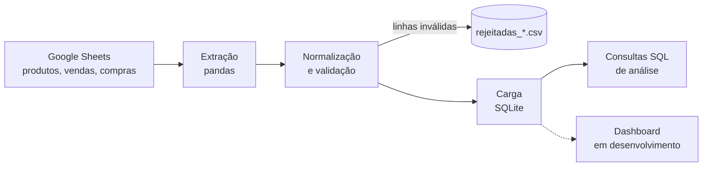
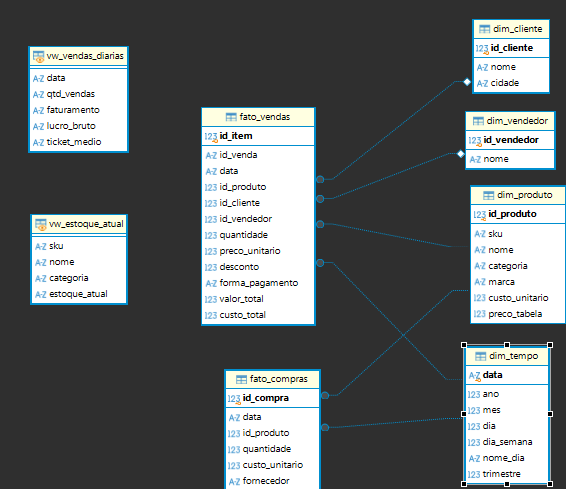

# Loja Data Pipeline

Pipeline de dados de vendas e estoque para uma loja física de celulares, motos elétricas, acessórios e perfumes. Coleta os registros da loja em uma planilha, valida e transforma os dados em Python, carrega em um banco com modelo dimensional e responde perguntas de negócio com SQL.

**Status:** em desenvolvimento (fases 0 a 6 concluídas; dashboard em andamento).

## Contexto de negócio

Projeto desenvolvido para a loja do meu irmão, em fase de inauguração, e usado como projeto de portfólio em engenharia de dados.

- **Produtos:** celulares, motos elétricas, acessórios e perfumes
- **Registro hoje:** planilha e WhatsApp
- **Pagamentos aceitos:** Pix, cartão (débito e crédito) e dinheiro
- **Garantia:** 1 ano na bateria e 3 meses nos acessórios, com assistência técnica
- **Volume inicial estimado:** cerca de 2 vendas por dia, com ações sazonais planejadas
- **Objetivo:** acompanhar o funcionamento da loja com dados para decidir o que comprar, o que promover e onde ajustar

## Arquitetura



## Stack

Python 3.11+, pandas, SQL (SQLite), pytest, Git/GitHub. Dashboard (Metabase ou Streamlit) e agendamento da execução nas próximas fases.

## Estrutura do projeto

```
loja-data-pipeline/
├──dashboards
|   ├──_init_.py
|   ├──app.py
|   ├──dados.py
├── config/settings.py          # caminhos, abas da planilha, formas de pagamento
├── src/
│   ├── extract.py              # lê as abas (planilha ou CSVs de exemplo)
│   ├── transform.py            # limpeza e padronização
│   ├── validate.py             # regras de qualidade de dados
│   ├── load.py                 # carga no SQLite
│   └── pipeline.py             # orquestra o ETL
├── sql/
│   ├── 01_create_tables.sql    # modelo dimensional
│   ├── 02_views.sql            # estoque atual e vendas diárias
│   └── 03_analises.sql         # 14 consultas de negócio
├── scripts/
│   ├── gerar_dados_ficticios.py
│   └── rodar_consulta.py       # executa as consultas pelo terminal
├── tests/                      # testes de transformação, validação e carga
├── data/sample/                # dados fictícios (únicos versionados)
└── docs/modelo_de_dados.png
```

## Modelo de dados



Esquema estrela com `fato_vendas` e `fato_compras` ao centro, cercadas pelas dimensões `dim_produto`, `dim_tempo`, `dim_vendedor` e `dim_cliente`.

Decisões de modelagem:

- **Granularidade:** uma linha de `fato_vendas` por item vendido (uma venda com dois itens gera duas linhas com o mesmo `id_venda`).
- **Custo no momento da venda:** `custo_total` é gravado na venda, então a margem histórica não muda quando o custo do produto muda.
- **Chave natural e substituta:** `sku` identifica o produto no negócio; `id_produto` é a chave do banco.
- **Estoque derivado:** o estoque atual é calculado pela view `vw_estoque_atual` (compras menos vendas), sem tabela própria.

## Como rodar

```bash
git clone https://github.com/Richardlcian/loja-data-pipeline.git
cd loja-data-pipeline

python -m venv .venv
source .venv/Scripts/activate      # Linux/macOS: source .venv/bin/activate
pip install -r requirements.txt

cp .env.example .env               # mantenha USE_SAMPLE=true para usar dados fictícios
python scripts/gerar_dados_ficticios.py
python -m src.pipeline
```

Com `USE_SAMPLE=true` o pipeline lê os CSVs de `data/sample/`. Com `USE_SAMPLE=false` ele lê a planilha indicada em `SHEET_ID` (compartilhada como "qualquer pessoa com o link pode ver").

Para rodar as análises:

```bash
python scripts/rodar_consulta.py          # lista as consultas
python scripts/rodar_consulta.py 12       # roda a consulta 12 (curva ABC)
python scripts/rodar_consulta.py 12 --csv # também salva em data/processed/
```

Para rodar os testes:

```bash
pytest
```

## Qualidade de dados

Linhas inválidas não derrubam o pipeline: são separadas em `data/processed/rejeitadas_*.csv`, com o motivo ao lado, e as demais seguem.

| Regra | Aplica-se a |
|---|---|
| Data inválida (formato `aaaa-mm-dd`) | vendas, compras |
| Quantidade menor ou igual a zero, ou não inteira | vendas, compras |
| Preço ou custo inválido ou negativo | produtos, vendas, compras |
| Desconto negativo ou maior que o valor do item | vendas |
| SKU inexistente no cadastro de produtos | vendas, compras |
| Forma de pagamento fora de Pix, Cartão de débito, Cartão de crédito, Dinheiro | vendas |
| Linha duplicada (mesmo `id_venda` e `sku`) | vendas |
| `id_venda` vazio | vendas |

Outras garantias:

- **Idempotência:** as tabelas de fatos são recarregadas por inteiro a cada execução. Rodar o pipeline várias vezes dá o mesmo resultado, e correções feitas na planilha chegam ao banco.
- **Transação com rollback:** se a carga falhar, o banco volta ao estado anterior.
- **Reconciliação:** após a carga, o pipeline confere se a contagem e o faturamento no banco batem com o calculado.
- **Números ambíguos são rejeitados:** valores com vírgula decimal (`29,9`) não são convertidos em silêncio, para nunca gerar dado falso.
- **Testes automatizados:** 12 testes cobrindo transformação, validação e idempotência da carga.

## Análises

As consultas de `sql/03_analises.sql` respondem a perguntas do dia a dia da loja. Nas consultas 3, 4 e 5, "hoje" é a data da última venda registrada.

| # | Pergunta de negócio | Técnica de SQL |
|---|---|---|
| 1 | Como foi cada mês? | `GROUP BY`, `JOIN` |
| 2 | Qual categoria dá mais faturamento e margem? | subconsulta |
| 3 | O que mais vendeu nos últimos 30 dias? | CTE |
| 4 | Quais produtos estão parados no estoque? | `LEFT JOIN`, `HAVING` |
| 5 | Quantos dias o estoque aguenta? | CTE, `NULLIF` |
| 6 | Quais dias da semana vendem mais? | dimensão de tempo |
| 7 | Como os clientes pagam? | participação percentual |
| 8 | Como vai cada vendedor? | `LEFT JOIN`, `COALESCE` |
| 9 | Esta semana foi melhor que a anterior? | função de janela `LAG` |
| 10 | Qual a tendência, sem o ruído diário? | média móvel |
| 11 | Qual o melhor produto de cada categoria? | `RANK`, `PARTITION BY` |
| 12 | Quais produtos sustentam o faturamento? | curva ABC (soma acumulada) |
| 13 | Quanto desconto está sendo dado? | agregação condicional |
| 14 | Quais produtos geram mais lucro? | margem por produto |

### Exemplos de resultado (dados fictícios)

**Faturamento e margem por categoria (consulta 2)**

| categoria | unidades | faturamento | lucro_bruto | margem_pct | % do faturamento |
|---|---|---|---|---|---|
| Celular | 61 | 91.892,33 | 33.812,33 | 36,8 | 43,2 |
| Moto elétrica | 11 | 89.612,16 | 25.612,16 | 28,6 | 42,2 |
| Acessório | 175 | 18.831,87 | 11.782,87 | 62,6 | 8,9 |
| Perfume | 62 | 12.259,02 | 7.043,02 | 57,5 | 5,8 |

**Curva ABC (consulta 12): 10 primeiros produtos**

| sku | produto | categoria | receita | % acumulado | classe |
|---|---|---|---|---|---|
| MOTO-002 | Moto elétrica Volt 1500W | Moto elétrica | 42.980,52 | 20,2 | A |
| MOTO-001 | Moto elétrica Volt 800W | Moto elétrica | 36.651,64 | 37,5 | A |
| CEL-005 | Smartphone Gama Pro 256GB | Celular | 22.717,01 | 48,1 | A |
| CEL-002 | Smartphone Alfa 256GB | Celular | 19.746,91 | 57,4 | A |
| CEL-004 | Smartphone Beta 128GB | Celular | 15.346,99 | 64,7 | A |
| CEL-003 | Smartphone Beta 64GB | Celular | 13.745,65 | 71,1 | A |
| CEL-001 | Smartphone Alfa 128GB | Celular | 13.346,04 | 77,4 | A |
| MOTO-003 | Scooter elétrica Zip 500W | Moto elétrica | 9.980,00 | 82,1 | A |
| CEL-006 | Smartphone Gama Lite 64GB | Celular | 6.989,73 | 85,4 | B |
| ACE-006 | Power bank 10000mAh | Acessório | 5.805,15 | 88,1 | B |

Resumo das classes: 8 produtos na classe A (82% da receita), 6 na B (cerca de 13%) e 8 na C (menos de 5%).

**O que os números mostram:** celulares e motos elétricas somam cerca de 85% do faturamento, mas as motos têm a menor margem (28,6%). Acessórios e perfumes vendem muitas unidades (237 juntas) e têm margem de 57% a 63%, porém pesam pouco no faturamento (cerca de 15%). Na curva ABC, 8 dos 22 produtos (3 motos e 5 celulares) formam a classe A, e só a moto Volt 1500W responde por 20% da receita. Os 8 produtos da classe C somam menos de 5%. Como os dados são fictícios, os valores ilustram o método; com dados reais, essa leitura ajuda a decidir o que comprar, o que promover e o que repensar no estoque.

## Dashboard

Painel interativo em Streamlit com indicadores comparados ao período anterior, evolução de vendas, curva ABC, alertas de estoque e análise por forma de pagamento e vendedor.


Para abrir: `streamlit run dashboards/app.py`

### Cuidados ao interpretar

- Com poucas vendas por dia, a variação semanal oscila muito; a média móvel (consulta 10) e períodos mais longos dão uma leitura mais estável.
- A `dim_tempo` guarda só as datas com venda ou compra, então as análises por dia da semana usam totais, não médias por dia.
- A margem é lucro bruto (receita menos custo do produto), sem taxas de cartão, aluguel ou impostos.

## Privacidade

O repositório contém apenas **dados fictícios** (`data/sample/`). Dados reais da loja, o banco `loja.db`, o arquivo `.env` e os logs ficam fora do Git.

## Roteiro

- [x] Fase 0: ambiente e repositório
- [x] Fase 1: entendimento do negócio
- [x] Fase 2: planilha e dados fictícios
- [x] Fase 3: modelo de dados no SQLite
- [x] Fase 4: pipeline ETL com validação e testes
- [x] Fase 5: consultas SQL de análise
- [x] Fase 6: dashboard
- [ ] Fase 7: execução automática diária
- [ ] Fase 8: observabilidade (alertas, backup, CI)

**Evoluções planejadas:** garantia por produto, tabela de assistência técnica, calendário de datas sazonais para comparar promoções, PostgreSQL, carga incremental e dbt.

## Autor

Richard Lucian — estudante de Ciência da Computação (UFRRJ), com foco em Engenharia de Dados.
[LinkedIn](https://www.linkedin.com/in/richard-lucian)
